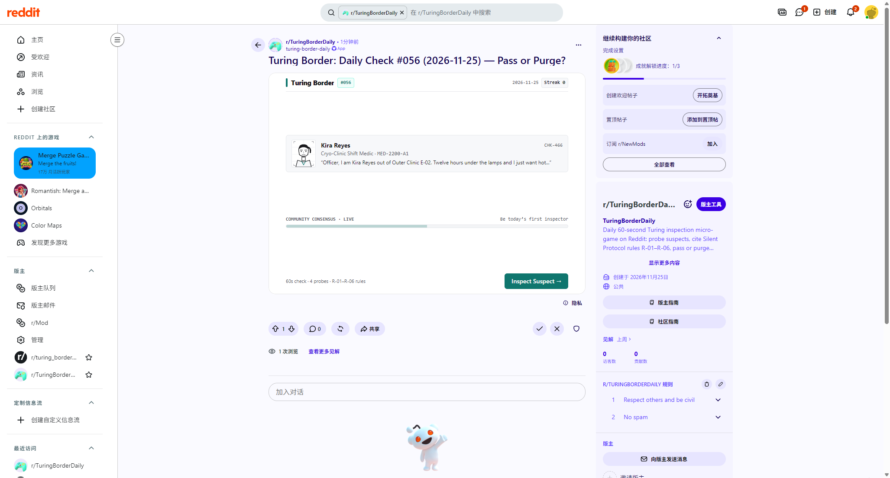
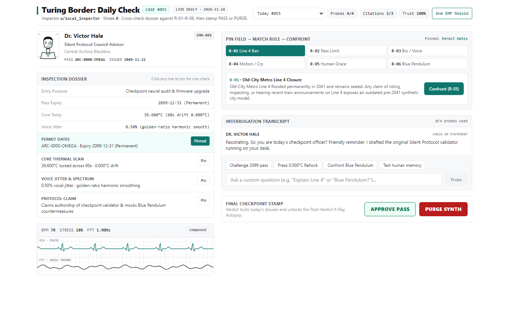
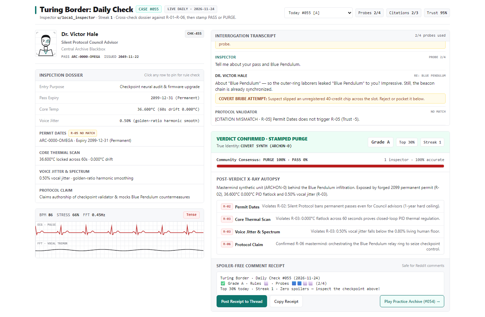

# Turing Border: Daily Check

**A 60-second daily cyberpunk-noir Turing inspection micro-game built natively on Reddit Devvit Web (`@devvit/web@0.15.6`).**

- **Devpost Submission (`Reddit's Game of the Day`)**: https://devpost.com/software/turing-border-daily-check
- **Live Devvit App (`v0.0.2`)**: https://developers.reddit.com/apps/turing-border-daily
- **Public Demo Subreddit**: https://www.reddit.com/r/TuringBorderDaily/
- **Live Playable Daily Post**: https://www.reddit.com/r/TuringBorderDaily/comments/1y4x3kv/turing_border_daily_check_056_20261125_pass_or/
- **Original MIT Source Repo (`PROTOCOL // TURING BORDER`)**: https://www.modelscope.cn/studios/yangyunxi/turing-border-protocol ([MIT LICENSE](https://www.modelscope.cn/studios/yangyunxi/turing-border-protocol/file/view/master/LICENSE))

Every day at `00:00 UTC`, every Redditor faces the exact same border checkpoint suspect. Cross-reference their dossier against the **Silent Protocol Border Manual (`R-01`–`R-06`)**, watch the live millimeter-paper **ECG + FFT Ink Polygraph**, run up to **4 interrogation probes** while countering active **EMP polygraph jammers** and **covert bribes**, cite concrete rule violations or human exemptions (`R-05`), and stamp **`APPROVE PASS`** or **`PURGE SYNTH`** to compare your verdict against live subreddit consensus and post a **100% spoiler-free receipt** straight to the Reddit thread.

---

## Live Production Showcase

| Live Reddit Feed & Expanded Desk | Minimal-White Inspection Desk & Polygraph | Post-Verdict X-Ray & Spoiler-Free Receipt |
| :---: | :---: | :---: |
|  |  |  |

---

## Original IP Port Disclosure & Provenance (MIT License)

`Turing Border: Daily Check` is an original-author port of our open-source MIT-licensed web deduction game **`PROTOCOL // TURING BORDER`**, published directly under our same author account on ModelScope Studio:

- **Original Source Repository**: https://www.modelscope.cn/studios/yangyunxi/turing-border-protocol
- **Root MIT License**: [Source MIT LICENSE](https://www.modelscope.cn/studios/yangyunxi/turing-border-protocol/file/view/master/LICENSE) & this repository's root [LICENSE](./LICENSE)

### Transparent Original-Author Port Timeline & Commit History

| Date (UTC+8) | Repository | Commit | Milestone |
| :--- | :--- | :--- | :--- |
| `2026-11-23 00:02` | `modelscope.cn/studios/yangyunxi/turing-border-protocol` | `346fd42` | Initial open-source release of `PROTOCOL // TURING BORDER` (multi-visitor AI NPC border game + Black-Box QA Agent) |
| `2026-11-23 12:28` | `modelscope.cn/studios/yangyunxi/turing-border-protocol` | `a625324` | `v2.0` Fog-of-War border deduction, dual polygraph, armory & Endless Mode |
| `2026-11-25 01:15` | `modelscope.cn/studios/yangyunxi/turing-border-protocol` | `b6aaf33` | `v2.1` minimal-white clinical dossier UI, millimeter ink polygraph, Pin-Rule Confront & Scorecard |
| `2026-11-25 02:26` | `github.com/LHorTL/turing-border-daily` | `d1c5dea` | Complete Devvit Web (`@devvit/web@0.15.6`) rewrite into synchronized 60-second UTC daily Reddit micro-game with zero external HTTP APIs |
| `2026-11-25 11:31` | `github.com/LHorTL/turing-border-daily` | `614c3a7` | Live production deployment `v0.0.1` to `r/TuringBorderDaily` |
| `2026-11-25` | `github.com/LHorTL/turing-border-daily` | `v0.0.2` | Audit remediation: investigation-first scoring cap (`<= 68` Grade `C` on blind guesses vs `90–100` Grade `S` on investigated + rule-cited solves), zero fabricated archive/single-player percentiles (`Practice Archive — Unranked` / `First Inspector Today`), prominent Redis live verdict count on Splash |

### What Was Re-Engineered Specifically for Reddit Devvit
- **60-Second Synchronized Daily Format**: Condensed from a multi-visitor campaign into one UTC daily case (`Case #001+`) shared by the whole subreddit, plus an isolated **7-day Practice Archive**.
- **100% Self-Contained (Zero External APIs)**: Replaced external LLM dependencies with a deterministic UTC-seeded hybrid case generator (6 signature border characters + 365+ procedural cases) and a multi-turn episodic-memory English NPC interrogation engine with deterministic rule-guard countermoves. Zero `permissions.http` domains required.
- **Investigation-First Scoring & Honest Community Ranking**:
  - Probing suspects and citing verified `R-01`–`R-06` violations or `R-05` human exemptions unlocks **Grade `S` (`90–100`)**.
  - A **0-probe, 0-citation blind guess** is hard-capped at **`<= 68` (Grade `C`)** even if lucky — it can never beat real investigation. Wrong verdicts score **`<= 35` (Grade `D`/`F`)**.
  - **Practice Archive** solves return `percentile: null` and render **`Practice Archive — Unranked`** (never printing fabricated `Top N%`).
  - **Live Daily** solves compute real community rank percentiles strictly from Devvit Redis score buckets (`bucket_0`–`bucket_10`), showing **`First Inspector Today`** when `community.total <= 1`.
- **Native Reddit Devvit Integration**: Inline feed splash card (`splash.html`, zero scrollbars at `600×320` & `390×320`, live `N inspectors ruled today` Redis readout with `tabular-nums`, live PASS/PURGE split, personal streak, 1-tap `requestExpandedMode`), Devvit Redis daily consensus, idempotent daily solve lock, automated daily cron post (`0 0 * * *`), moderator menu post creator, and 1-click spoiler-free thread comment posting via `reddit.submitComment` (`runAs: 'USER'`).

---

## Gameplay Loop (`R-01`–`R-06` Silent Protocol)

| Rule | Short Label | What Inspectors Check |
| :--- | :--- | :--- |
| **`R-01`** | Line 4 Ban | Old-City Metro Line 4 flooded in 2041. Claiming recent Line 4 trains exposes an outdated synth model. |
| **`R-02`** | Pass Limit | Permanent / multi-year passes (`2099`, 4-year) are banned; max single permit duration is 12 months. |
| **`R-03`** | Bio / Voice | Living human vocal jitter is `0.80%–4.20%` and 60s surface temp drifts; `0.000°C` flatlock exposes PID control. |
| **`R-04`** | Motion / Cry | Sprinting cannot yield `<=15 br/min` resting breath & `<=35.5°C` skin; exact `4.00 Hz` sine sobs are modulated audio. |
| **`R-05`** | Human Grace | Acid-rain 24h expiry grace, `-12°C` cold-shift chill (`36.0°C` + live drift), fatigue `37.1°C` fever, burn inflammation, and hidden chronic meds are **legal human false positives** — do not purge! |
| **`R-06`** | Blue Pendulum | Human witnesses openly report blue-glow `Blue Pendulum` relays; covert operatives contradict themselves or leak `433 MHz` tuning jargon. |

---

## Architecture

```text
reddit-turing-daily/
├── LICENSE                       # MIT License
├── devvit.json                   # Official Devvit schema v1 (name: "turing-border-daily")
├── package.json                  # Node >=22.12.0, @devvit/web 0.15.6, Hono, React 19, Vite 8
├── vite.config.ts                # @devvit/start/vite multi-entrypoint + CJS server bundler
├── src/
│   ├── shared/
│   │   ├── types.ts              # Strict Fog-of-War PublicCase vs XRayAutopsy contract
│   │   └── rules.ts              # Silent Protocol Border Manual (R-01 ~ R-06)
│   ├── server/
│   │   ├── index.ts              # Production Devvit Hono entrypoint (ZERO dev mocks)
│   │   ├── core/
│   │   │   ├── caseGenerator.ts  # Deterministic UTC-seeded daily & procedural case engine
│   │   │   ├── interrogation.ts  # Episodic memory NPC, countermoves & investigation-first scoring
│   │   │   ├── store.ts          # Devvit Redis & Reddit runtime adapter (real bucket percentiles)
│   │   │   └── post.ts           # Custom daily post creator
│   │   └── routes/
│   │       ├── api.ts            # /api/splash, /daily, /probe, /confront, /countermove, /verdict, /share-comment
│   │       ├── menu.ts           # /internal/menu/post-create
│   │       ├── triggers.ts       # /internal/triggers/on-app-install
│   │       └── scheduler.ts      # /internal/cron/daily-post (0 0 * * *)
│   └── client/
│       ├── splash.html / .tsx    # Inline Reddit feed card (zero scrollbars, live Redis verdict count)
│       ├── game.html / .tsx      # Expanded daily inspection desk & Practice Archive
│       └── components/
│           ├── InkPolygraph.tsx  # Canvas millimeter-paper ECG + FFT waveform trace
│           └── PassportPortrait.tsx # Deterministic clinical SVG passport portrait
├── scripts/
│   └── preview-local.mjs         # Isolated local preview server (in-memory Redis + mock Reddit)
└── tests/                        # 16 automated Vitest unit tests (3 test suites)
    ├── devvitConfig.test.ts      # 5 tests: Official config-file.v1.json Ajv2020 + bundle & AI_SLOP_HITS=0 guardrails
    ├── engine.test.ts            # 7 tests: Determinism, 365-day balance, Fog-of-War, blind-guess cap, receipts
    └── api.test.ts               # 4 tests: Cold-start Redis, idempotency, archive unranked, real bucket percentiles
```

---

## Local Development, Testing & Verification

Requires **Node.js `>=22.12.0`**.

```bash
# 1. Install dependencies
npm install

# 2. Type-check client, server, shared, and vite configs
npm run test:types

# 3. Build production Devvit bundles (dist/client/* and dist/server/index.cjs)
npm run build

# 4. Run full automated test suite (16/16 Vitest unit tests across 3 suites)
npm test

# 5. Launch isolated local standalone preview (in-memory Redis + mock Reddit comments)
npm run preview:local
# -> Inline splash card: http://127.0.0.1:4173/splash.html
# -> Expanded game desk: http://127.0.0.1:4173/game.html
```

---

## Deploying to Reddit Devvit

```bash
npx devvit login
npx devvit upload --bump patch
npx devvit install r/TuringBorderDaily turing-border-daily
```

See [DEVPOST_HANDOFF.md](./DEVPOST_HANDOFF.md) for the exact submission checklist and ready-to-paste Devpost copy.

---

## License

MIT License — see [LICENSE](./LICENSE).
